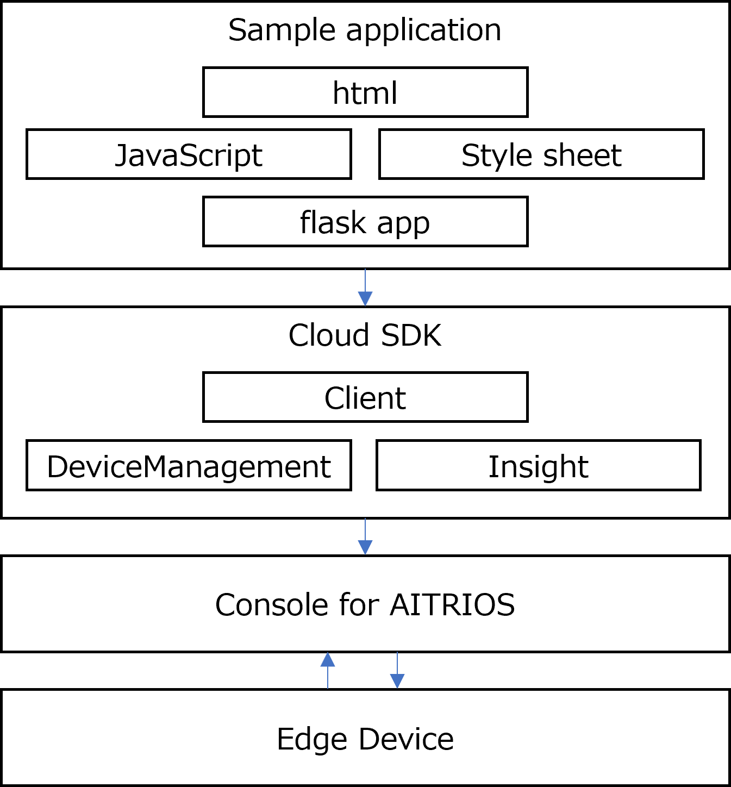
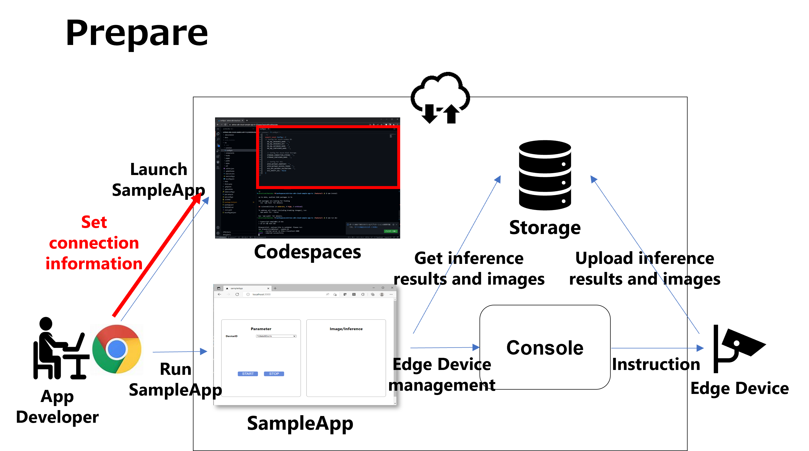
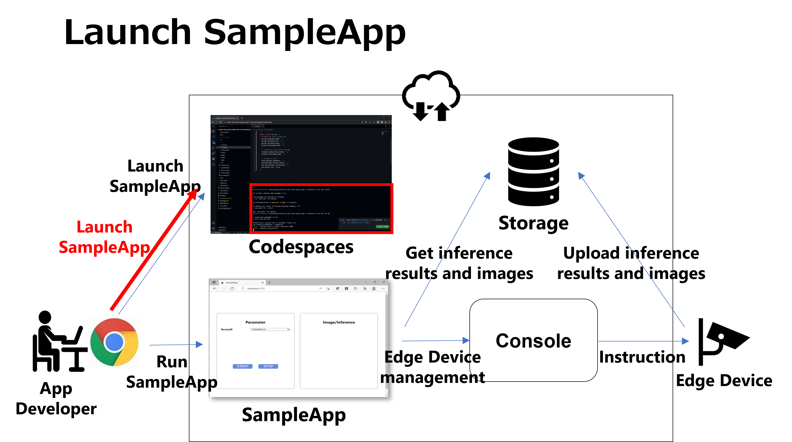
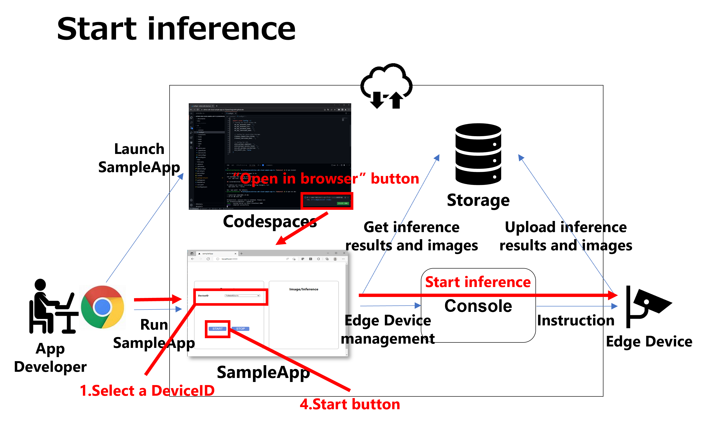
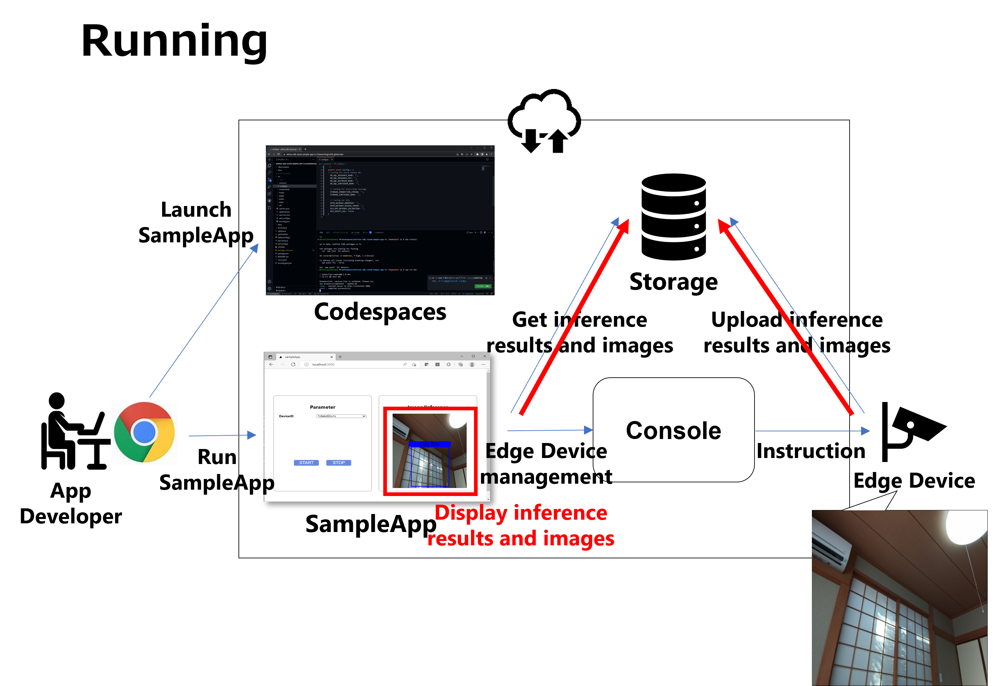
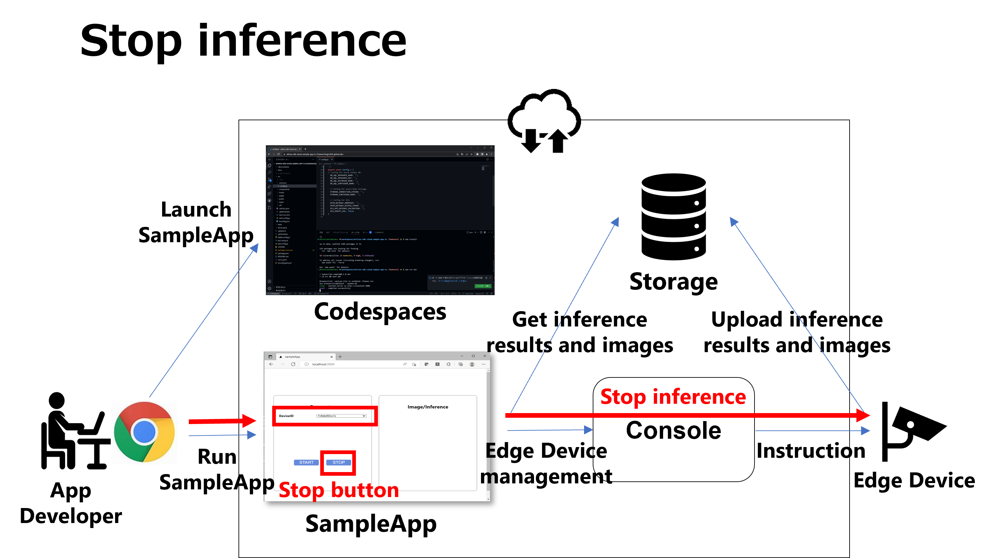

= Cloud SDK pass:[ ] Sample Application pass:[ ] Python pass:[ ] Tutorial pass:[ ] 
:sectnums:
:sectnumlevels: 1
:author: Copyright 2023 Sony Semiconductor Solutions Corporation
:version-label: Version 
:revnumber: x.x.x
:revdate: YYYY - MM - DD
:trademark-desc1: AITRIOS™ and AITRIOS logos are the registered trademarks or trademarks
:trademark-desc2: of Sony Group Corporation or its affiliated companies.
:toc:
:toc-title: TOC
:toclevels: 1
:chapter-label:
:lang: en

== Change history

|===
|Date |What/Why 

|2022/12/12
|Initial draft

|2023/01/30
|Fixed typos + 
Unified the swinging of expressions + 
Fixed the notation + 
Fixed the text size of pictures + 
Updated the PDF build environment +
Removed the [console_access_settings.yaml] from the sample application repository structure +
Changed the procedure for setting the connection information in the "Prepare to run the sample application" +
Changed implementation description for each use case for "**Cloud SDK**" 0.2.0

|2023/05/26
|Fixed the "Reference materials" in "Sample application repository structure" with FlatBuffers version up +
Fixed a lack of FlatBuffers in the "Package (framework) on which the sample application depends" +
Fixed a code misquote in the "Implementation description for each use case" + 
Fixed parenthesis notation for tool names + 
Added alternate text to images

|2023/09/26
|Console Developer Edition and Console Enterprise Edition support

|2023/12/05
|AWS support
|===

== Introduction
This tutorial explains a sample application using the "**Cloud SDK**". + 
This sample application demonstrates the basic use of the "**Cloud SDK**". + 

In the sample application, one can check how to control the Edge Devices using "**Cloud SDK**" and also how to verify the output of the Edge Devices uploaded to either to the "**Console for AITRIOS**" (hereafter referred to as "**Console**") or Azure  Blob Storage or Amazon S3 or Local Storage.
However, Codespaces cannot be used when checking the inference results uploaded to Local Storage.

[#_precondition]
== Prerequisite
=== Connection information
To use the sample application, you need connection information to access the "**Console**" from the application. + 
The acquired information is used in <<#_Execute_sampleapp,"1.Prepare to run the sample application">>. + 
The required information is as follows:

* Client application details
- When "**Console Developer Edition**" is used 
** Refer to the client application list in "**Portal for AITRIOS**" or register the client application for the sample application based on the requirement and obtain the following information. For 
details, refer to "Issuing a Client Secret for SDK" in the https://developer.aitrios.sony-semicon.com/en/edge-ai-sensing/documents/portal-user-manual/["**Portal User Manual**"].

*** Client ID
*** Secret
+

** Get the following information from link:++https://developer.aitrios.sony-semicon.com/en/file/download/edge-ai-sensing-portal-console-end-point-info/++["**Portal and Console endpoint information**"].
*** Console endpoint
*** Portal authorization endpoint

- When using "**Console Enterprise Edition**"
** Please contact "**Console**" deployment representative (Service Administrator).

- For using Azure Blob Storage, connection information is required to access Azure Blob Storage. +
For details, refer https://learn.microsoft.com/en-us/azure/storage/common/storage-configure-connection-string#configure-a-connection-string-for-an-azure-storage-account["**Configure a connection string for an Azure storage account**"].
- To use Amazon S3, connection information is required to access Amazon S3.
** Please obtain the following information by referring to https://docs.aws.amazon.com/IAM/latest/UserGuide/id_credentials_access-keys.html#Using_CreateAccessKey["**AWS Identity and Access Management**"].
*** Access key ID
*** Secret access key
+
NOTE: Use an account without MFA setting for external transfer settings for obtaining the AccessKey that is used in external transfer settings or applications.

** Please obtain the following information by referring to https://docs.aws.amazon.com/AWSEC2/latest/UserGuide/using-regions-availability-zones.html["**User Guide for Linux Instances**"] 
*** Region

** Create a bucket referring to https://docs.aws.amazon.com/AmazonS3/latest/userguide/create-bucket-overview.html["**Amazon Simple Storage Service (S3)**"] and obtain the following information.
*** Bucket name

=== Edge Devices
In order for the sample application to work properly, the Edge Device must have specific settings. + 
Required settings are as follows:

* AI model and application are deployed
* AI model based on object detection is deployed
* From the "**Console**" UI, set the Command Parameter File to be used to the following setting:
+

** When using "**Console**" +
When not described, the following values are set automatically. +
UploadMethod="BlobStorage" +
UploadMethodIR="Mqtt"
** When using Azure Blob Storage/Amazon S3 +
UploadMethod="BlobStorage" +
UploadMethodIR="BlobStorage"
** When using Local Storage +
UploadMethod="HTTPStorage" +
UploadMethodIR="HTTPStorage"
+
** All common upload locations +
NumberOfInferencesPerMessage=1 +
FileFormat="JPG" +
Mode=1
+
** Other parameters need to be changed depending on the AI model and application content

=== External transfer settings
* When using Azure Blob Storage +
When using Azure Blob Storage, complete the setting of the external transfer setting tutorial (Azure Blob Storage).
* When using Amazon S3 +
When using Amazon S3, complete the settings in the External transfer settings tutorial (Amazon S3).
* When using Local Storage +
When using Local Storage, complete the settings in the External transfer settings tutorial (Local HTTP Server).
+
IMPORTANT: Uploads from the Edge Device to HTTP Server are not encrypted due to HTTP communication.

== Sample application operating environment
See the https://developer.aitrios.sony-semicon.com/en/edge-ai-sensing/documents/sdk-getting-started/["**SDK Getting Started**"].

== Sample application functional overview
The sample application implements the functionality required to specify an Edge Device enrolled in the "**Console**" and get inference results and images. + 
The following three functions are implemented:

* Get information about Edge Devices enrolled in the "**Console**"
* Instruct Edge Devices to start/stop inference
+

By starting inference, the Edge Device uploads the inference results/images to either the "**Console**", Azure Blob Storage, Amazon S3 or Local Storage. 

+ 
* Obtain the inference results/images and display the fetched results. 
+ 
Displays the data uploaded to "**Console**", Azure Blob Storage, Amazon S3 or Local Storage

== Sample application repository configuration
Sample application operating environment is as follows: + 
Omit parts that are not relevant to the implementation.
----
aitrios-sdk-cloud-app-sample-python
├── src (1)
│   ├── __init__.py
│   ├── app.py  (2)
│   ├── common
│   │   ├── __init__.py
│   │   ├── deserialize  (3)
│   │   │   ├── __init__.py
│   │   │   ├── BoundingBox.py
│   │   │   ├── BoundingBox2d.py
│   │   │   ├── GeneralObject.py
│   │   │   ├── ObjectDetectionData.py
│   │   │   └── ObjectDetectionTop.py
│   │   ├── storage
│   │   │   ├── __init__.py
│   │   │   ├── get_aws_storage.py (4)
│   │   │   ├── get_azure_storage.py (5)
│   │   │   ├── get_console_storage.py (6)
│   │   │   ├── get_local_storage.py (7)
│   │   ├── get_client.py  (8)
│   │   └── get_deserialize_data.py  (9)
│   │   └── get_storage_data.py  (10)
│   │   └── util.py  (11)
│   ├── static
│   │   ├── css
│   │   │   ├── Home.module.css  (12)
│   │   │   └── reset.css  (13)
│   │   └── js
│   │       ├── label.json  (14)
│   │       └── sample.js  (15)
│   └── templates
│       └── index.html  (16)
----
(1) src : Sample application folder +
(2) app.py : Main process of flask application. Implement features with various REST APIs +
(3) deserialize : Folder where the source code for deserialize is stored +
(4) get_aws_storage.py : Logic to obtain inference results and images from Amazon S3 +
(5) get_azure_storage.py : Logic to obtain inference results and images from Azure Blob Storage +
(6) get_console_storage.py :Logic to obtain inference results and images from "**Console**" +
(7) get_local_storage.py : Logic to fetch inference results and images from Local Storage +
(8) get_client.py : Generates a client of "**Console Access Library**" +
Logic to fetch the information to connect to the Azure Blob Storage +
Specify the path of Local Storage. +
(9) get_deserialize_data.py : Source code to deserialize the inference result +
(10) get_storage_data.py : Determines the Storage to use and invokes the logic of the appropriate Storage +
(11) util.py : Logic that can be used universally in multiple files +
(12) Home.module.css : Front end style sheet of the sample application +
(13) reset.css : Front end style sheet of the sample application +
(14) label.json : Displays label of the inference results +
(15) sample.js : JavaScript logic that runs in the front-end UI of the sample application +
(16) index.html : Front-end UI of the sample application

=== Source code commentary

The following figure provides an overview of the sample application:

The sample application consists of the Flask framework.

Call the "**Cloud SDK**" from the sample application to control the Edge Device through the "**Console**". + 
The data obtained by the Edge Device is saved either in the "**Console**", "Azure Blob Storage" or "Amazon S3" or "Local Storage". + 
The sample application uses "**Cloud SDK**" and fetches the data from either the "**Console**" or "Azure Blob Storage" or "Amazon S3" or "Local Storage".

=== Package (framework) on which the sample application depends

* "**Console Access Library**"
* https://flask.palletsprojects.com/en/2.2.x/[Flask]
* https://google.github.io/flatbuffers/[FlatBuffers]
* https://pypi.org/project/pytz/[pytz]
* https://pypi.org/project/azure-storage-blob/[azure-storage-blob]
* https://aws.amazon.com/sdk-for-python/[boto3]

[#_Execute_sampleapp]
== How to run the sample application
Use the connection information prepared in the <<#_precondition,"Prerequisite">>

=== 1.Prepare to run the sample application
. In Codespaces or in an environment where the repository is cloned, create [console_access_settings.yaml] under [src/common] and set the connection destination information.

- When "**Console Developer Edition**" is used
+
|===
|src/common/console_access_settings.yaml
a|
[source, Yaml]
----
console_access_settings:
  console_endpoint: "Console endpoint"
  portal_authorization_endpoint: "Portal authorization endpoint"
  client_secret: "Secret"
  client_id: "Client ID"
----
|===
+
* Specify the Console Endpoint in the `**console_endpoint**`. +
* Specify the Portal authentication endpoint in `**portal_authorization_endpoint**`. +
* Specify the Secret of the registered application in `**client_secret**`. +
* Specify the Client ID of the registered application in the `**client_id**`. +
+

IMPORTANT: For details on how to obtain the Client ID and Secret, please refer "Issue the Client Secret for SDK" in the https://developer.aitrios.sony-semicon.com/en/edge-ai-sensing/documents/portal-user-manual/["**Portal User Manual**"]. + 
For details on how to obtain the Console endpoint and the Portal authentication endpoint, please refer to link:++https://developer.aitrios.sony-semicon.com/en/file/download/edge-ai-sensing-portal-console-end-point-info/++["**Portal and Console endpoint information**"]. + 
This is the information to access the "**Console**". + 
Do not disclose it to the public or share it with others and handle it with caution.
+
NOTE: When executing the sample application in a Proxy environment set the environment variable `**https_proxy**`.

- When "**Console Enterprise Edition**" is used
+
|===
|src/common/console_access_settings.yaml
a|
[source, Yaml]
----
console_access_settings:
  console_endpoint: "Console endpoint"
  portal_authorization_endpoint: "Portal authorization endpoint"
  client_secret: "Secret"
  client_id: "Client ID"
  application_id: "Application ID"
----
|===
+
* Specify the Console endpoint in the `**console_endpoint**`. +
* Specify the Portal authentication endpoint in `**portal_authorization_endpoint**`. +
The Portal authentication endpoint is to be specified in a `**\https://login.microsoftonline.com/{tenantID}**` format. +
* Specify the Secret of the registered application in `**client_secret**`. +
* Specify the Client ID of the registered application in the `**client_id**`. +
* Specify the Application ID of the registered application in `**application_id**`. +
+

IMPORTANT: For details on how to fetch the Console endpoint, Client ID, Secret and Tenant ID and Application ID, please contact "**Console**" deployment representative (Service Administrator). +
Do not disclose it to the public or share it with others, handle it with care. +
+
NOTE: When executing the sample application in a Proxy environment, set the environment variable `**https_proxy**`.

. In Codespaces or in an environment where the repository is cloned, create [azure_access_settings.yaml] under [src/common] and set the connection destination information. +
This setting is set when the destination to obtain the inference results is Azure Blob Storage. 

+
|===
|src/common/azure_access_settings.yaml
a|
[source,Yaml]
----
azure_access_settings:
  connection_string: "Connection information"
  container_name: "Container name"
----
|===

* Specify the Connection information of Azure Blob Storage in `**connection_string**`.  +
* Specify the Container name of Azure Blob Storage in `**container_name**`.
+

IMPORTANT: These are the access information to Azure Blob Storage. +
Do not disclose it to the public or share it with others and handle it with caution. +

.	Create [aws_access_settings.yaml] under [src/common]  in the environment where the repository is cloned or in Codespaces and set the connection destination information.

+
|===
|src/common/aws_access_settings.yaml
a|
[source,Yaml]
----
aws_access_settings:
  bucket_name: "Bucket name"
  access_key_id: "Access key ID"
  secret_access_key: "Secret access key"
  region: "Region"
----
|===
+
* Set `**bucket_name**` to the Amazon S3 bucket name.
* In `**access_key_id**`, specify the access key ID of Amazon S3. 
* Specify the Amazon S3 secret access key in `**secret_access_key**`.
* In `**region**`, specify the Amazon S3 region.
+

IMPORTANT:  These are the access information to Amazon S3. +
 Do not disclose it to the public or share it with others and handle it with caution. +

. In Codespaces or in an environment where the repository is cloned, set the connection destination information in [get_client.py] under [src/common].
+
|===
|src/common/get_client.py
a|
[source,Python]
----
class Service(Enum):
    Console = auto()
    Azure = auto()
    AWS = auto()
    Local = auto()

CONNECTION_DESTINATION = Service.Console
LOCAL_ROOT = ""
----
|===
+
* Set the destination to obtain the inference result in `**CONNECTION_DESTINATION**`. The default value is the `**Service.Console**` setting. +
* Specify the path for Local Storage `**LOCAL_ROOT**`. +
This setting is used when `**Service.Local**` is specified in `**CONNECTION_DESTINATION**`. +

NOTE: When using Dev Container environment, create a folder in the folder where Local Storage is git cloned and set `**LOCAL_ROOT**` to `**workspace/{ folder that is created within a git cloned folder}**`.

=== 2.Launch the sample application
Install the package and launch the sample application from either the terminal in the environment where the repository is cloned or from Codespaces.

....
$ pip install .
$ python src/app.py
....

=== 3.Start inference
Access the sample application from the browser and perform various operations.

. Open http://localhost:3000 (port forwarded URL in the case of Codespaces).
. Select a Device ID from the list of [**DeviceID**]
. Click the [**START**] to start inference for the Edge Device

=== 4.Review inference results and images
While inference is starting, the "**Image/Inference**" area displays an image and inference results.

=== 5.Stop inference
Click the [**STOP**] in the sample application to stop inference for the Edge Device.

== Implementation description for each use case

=== 1.Get information about Edge Devices enrolled in the "**Console**"

To use the "**Console**", generate a Client for the "**Cloud SDK**". + 
Use the functions provided by the "**Console**" from the generated Client.

* Import library 
+

[source, Python]
----
from console_access_library.client import Client
from console_access_library.common.config import Config
----
Import the libraries required for "**Cloud SDK**" client generation, as preceding.

* "**Cloud SDK**" client generation
+
[source, Python]
----
def get_console_client():
  config_obj = Config(
        read_console_access_settings_obj.console_endpoint,
        read_console_access_settings_obj.portal_authorization_endpoint,
        read_console_access_settings_obj.client_id,
        read_console_access_settings_obj.client_secret,
        read_console_access_settings_obj.application_id
    )
  client_obj = Client(config_obj)
  
  return client_obj
----
In the preceding source code, generate the client for the "**Cloud SDK**". + 
Specify the connection information to the `**Config**` and generate the `**config_obj**`. + 
Specify the `**config_obj**` to the `**Client**` and generate the `**client_obj**`.

* Get Edge Device information
+
[source, Python]
----
def get_devices():
  client_obj = get_console_client()
  client_obj.device_management.get_devices()
----
Call the `**get_console_client**` to generate the `**client_obj**` as preceding. + 
Get Edge Device information using the `**get_devices**` provided by the `**device_management**` of the `**client_obj**`.

* Get Edge Device parameters
+
[source, Python]
----
def get_command_parameter_file():
  client_obj = get_client.get_console_client()
  return client_obj.device_management.get_command_parameter_file()
----
Call the `**get_console_client**` to generate the `**client_obj**` as preceding. + 
Get Edge Device parameters using the `**get_command_parameter_file**` provided by the `**device_management**` of the `**client_obj**`.

=== 2.Instruct the Edge Devices to start inference

* Start inference
+
[source, Python]
----
def start_upload_inference_result():
  client_obj = get_console_client()
  return client_obj.device_management.start_upload_inference_result(device_id="device_id")
----
Call the `**get_console_client**` to generate the `**client_obj**` as preceding. +
Start inference using the `**start_upload_inference_result**` provided by the `**device_management**` of the `**client_obj**`.

=== 3.Get inference results and images from the "**Console**"

Use the functionality provided by client to get inference results and images from the "**Console**".

* Get an image list
+
[source, Python]
----
def get_image_from_console(device_id, sub_directory, order_by=None, skip=None, number_of_images=None):
    """Get the image from Console
    Args:
        device_id (str): Device id
        sub_directory (str): image file uploaded directory
        order_by (str): Sort order by date and time the image was created. DESC, ASC
        skip (int): Number of images to skip fetching
        number_of_images (int): Number of images acquired
    Returns:
     total_image_count (int): get images number
        images :[{
            contents (str): base64 encode image data
            name (str): image file name
        }]
    """
    client_obj = get_client.get_console_client()

    image_response = client_obj.insight.get_image_data(device_id=device_id, sub_directory_name=sub_directory, number_of_images=number_of_images, skip=skip, order_by=order_by)

    return image_response
----
Call the `**get_console_client**` to generate the `**client_obj**` as preceding. + 
Get the image list using the `**get_images**` provided by the `**insight**`. +

* Get the latest image and link it to the inference result
+
[source, Python]
----
  client_obj = get_client.get_console_client()
  image_response = client_obj.insight.get_image_data(device_id="device_id", sub_directory_name="sub_directory_name", number_of_images=1, skip=0, order_by="DESC")
  latest_image_data = "data:image/jpg;base64," + image_response["images"][0]["contents"]
  latest_image_ts = image_response["images"][0]["name"].replace(".jpg", "")
----
The preceding source code gets the latest image information from an image list. + 
Get the latest image data into the `**latest_image_data**`. + 
Get the timestamp of the latest image into the `**latest_image_ts**`. + 
Inference results and images are linked by their respective timestamps. + 
Call the function to get inference results linked to images using the `**latest_image_ts**`.

* Get inference results linked to the latest image
+
[source, Python]
----
def get_inference_from_console(device_id, start_time=None, end_time=None, number_of_inference_result=None):
  """Get inference_data from Console
  Args:
    device_id (str): Device id
    start_time: Parameters used in filter options.
    end_time: Parameters used in filter options.
    number_of_inference_result: Parameters used in filter options.
  Returns:
    inference_response: inference result
  """
  client_obj = get_client.get_console_client()
  filter = f"EXISTS(SELECT VALUE i FROM i IN c.Inferences WHERE i.T >= \'{start_time}\' AND i.T <= \'{end_time}\')"
  raw = 1
  time = None
  inference_response = client_obj.insight.get_inference_results(device_id, filter, number_of_inference_results=number_of_inference_result, raw=raw, time=time)
  inferences_response = []
  for inference in inference_response:
    inferences_response.append(inference["inference_result"]["Inferences"][0]["O"])
  return inferences_response

----
Call the `**get_console_client**` to generate the `**client_obj**` as preceding. + 
Get the list of inference results using the `**get_inference_results**` provided by the `**insight**`. + 
Specify the number of inference results to get by the `**number_of_inference_results**`. + 
`**raw**` is the argument for accessing the stored inference result. + 
Specify the timestamp of inference results to get by the `**time**`.

* Deserialize inference results
+
[source, Python]
----
deserialize_data = get_deserialize_data.get_deserialize_data(latest_inference_data)
----
The preceding source code converts the inference results gotten from the "**Console**" into a format that can be referenced. + 
See the https://github.com/SonySemiconductorSolutions/aitrios-sdk-deserialization-sample["Cloud SDK Deserialize Sample"] for details of this conversion process.

=== 4.Obtain the inference results and images of Azure Blob Storage
In order to obtain the inference results and images from Azure Blob Storage, use get_azure_storage.py available in the hooks directory.

* Obtain the image list
+
[source,Python]
----
def get_image_from_azure(retry_count, device_id, sub_directory, order_by="ASC", skip=0, number_of_images=50):
  """Get the image from Azure
    Args:
      retry_count (int): Number of retries on failure,
      device_id (str): Device id
      sub_directory (str): image file uploaded directory
      order_by (str): Sort order by date and time the image was created. DESC, ASC
      skip (int): Number of images to skip fetching
      number_of_images (int): Number of images acquired
    Returns:
      total_image_count (int): get images number
      images :[{
        contents (str): base64 encode image data
        name (str): image file name
      }]
  """
  image_response = {
    "total_image_count": 0,
    "images": []
  }
  access_info = get_client.get_azure_access_settings()
  blob_service_client = BlobServiceClient.from_connection_string(
    access_info["connection_string"])
  container_client = blob_service_client.get_container_client(
    access_info["container_name"])

  storage_path = f"{device_id}/image/{sub_directory}"
  blobs_list = container_client.list_blobs(storage_path)
  blob_name_array = []
  for blob in blobs_list:
    blob_name_array.append(blob.name)
  if order_by == "DESC":
    blob_name_array.sort(reverse=True)

  images = []

  for i in range(skip, skip + number_of_images):
    if i == number_of_images:
      break
    if i > len(blob_name_array):
      break
    blob_client = container_client.get_blob_client(blob_name_array[i])
    image = blob_client.download_blob()
    image_text = image.read()
    b64encoded = base64.b64encode(image_text)

    file_name = blob_name_array[i].rsplit("/", 1)[1]
    images.append({
      "name": file_name,
      "contents": b64encoded.decode()
    })

  if len(blob_name_array) != 0:
    image_response["total_image_count"] = len(blob_name_array)
    image_response["images"] = images
    return image_response

  if retry_count > 0:
    time.sleep(1)
    return get_image_from_azure(retry_count - 1,
                                device_id,
                                sub_directory,
                                order_by,
                                skip,
                                number_of_images)

  return image_response

----
Obtain the list of image file names using `**list_blobs**` provided by `**azure.storage.blob**`. +
Obtain image data by using  `**get_blob_client**` and `**download_blob**` and `**read**` by using `**azure.storage.blob**`. +
Creates an image file name, base64, and returns it together with `**total_image_count**`.

* Obtains the inference result associated with the latest image
+
[source,Python]
----
def get_inference_from_azure(retry_count, 
                            device_id, sub_directory,
                            start_inference_time=None,
                            end_inference_time=None,
                            number_of_inference_result=None):
  """Get inference_data from Azure
    Args:
      retry_count (int): Number of retries on failure
      device_id (str): Device id
      sub_directory (str): image file uploaded directory
      start_inference_time (str): start range.
      end_inference_time (str): end range.
      number_of_inference_result (int): Number of cases to get.
    Returns:
      inferences (arr): inference results
  """
  inferences = []
  access_info = get_client.get_azure_access_settings()
  blob_service_client = BlobServiceClient.from_connection_string(access_info["connection_string"])
  container_client = blob_service_client.get_container_client(access_info["container_name"])
  storage_path = os.path.join(device_id, "metadata", sub_directory)
  blobs = []

  for blob in container_client.list_blobs(storage_path):
    timestamp = blob.name.split("/")[3].replace(".txt", "")
    if (start_inference_time is None or timestamp >= start_inference_time) and\
        (end_inference_time is None or timestamp < end_inference_time):
        blobs.append(blob.name)
    if end_inference_time is not None and timestamp > end_inference_time:
      break

    if len(blobs) == number_of_inference_result:
      break

  if len(blobs) != 0:
    for blob_name in blobs:
      blob_client = container_client.get_blob_client(blob_name)
      inference = blob_client.download_blob(encoding="UTF-8")
      inference_text = inference.readall()
      inference_obj = json.loads(inference_text)
      inferences.append(inference_obj["Inferences"][0]["O"])
    return inferences

  if retry_count > 0:
    time.sleep(1)
    return get_inference_from_azure(retry_count - 1,
                                    device_id,
                                    sub_directory,
                                    start_inference_time,
                                    end_inference_time,
                                    number_of_inference_result)
  return inferences

----
Obtains the list of inference result file names using `**list_blobs**` provided by `**azure.storage.blob**`. +
Check whether the time stamp of the obtained inference result file name is within the specified range.  +
Obtain the inference result data using `**get_blob_client**` and `**download_blob**` and `**readall**` provided by `**azure.storage.blob**`. +
`**start_inference_time**` is a time stamp that indicates the search start position. +
`**end_inference_time**` is a time stamp that indicates the search end position. +
`**number_of_inference_result**` is the number of inference results to be obtained. + 

=== 5.Obtains the inference results and images of Amazon S3
get_aws_storage.py available under the storage directory is used to obtain the inference results and images from Amazon S3.

* Obtain the image list
+
[source,Python]
----
def get_image_from_aws(retry_count, device_id, sub_directory, order_by="ASC", skip=0, number_of_images=50):
    """Get the image from AWS
    Args:
        retry_count (int): Number of retries on failure
        device_id (str): Device id
        sub_directory (str): image file uploaded directory
        order_by (str): Sort order by date and time the image was created. DESC, ASC
        skip (int): Number of images to skip fetching
        number_of_images (int): Number of images acquired
    Returns:
        total_image_count (int): get images number
        images :[{
            contents (str): base64 encode image data
            name (str): image file name
        }]
    """
    image_response = {
        "total_image_count": 0,
        "images": []
    }
    access_info = get_client.get_aws_access_settings()
    access_key_id = access_info["access_key_id"]
    secret_access_key = access_info["secret_access_key"]
    region = access_info["region"]

    s3_client = _get_s3_client(access_key_id, secret_access_key, region)

    bucket_name = access_info["bucket_name"]
    prefix = f"{device_id}/image/{sub_directory}/"

    image_name_list = _get_key_list_from_aws(s3_client, bucket_name, prefix)
    if order_by == "DESC":
        image_name_list.sort(reverse=True)

    images = []

    for i in range(skip, skip + number_of_images):
        if i >= len(image_name_list):
            break
        image_name = image_name_list[i].split("/")[3]

        response = s3_client.get_object(Bucket=bucket_name, Key=image_name_list[i])
        contents = response["Body"].read()
        b64encoded = base64.b64encode(contents)

        images.append({
            "name": image_name,
            "contents": b64encoded.decode()
        })

    if len(image_name_list) != 0:
        image_response["total_image_count"] = len(image_name_list)
        image_response["images"] = images
        return image_response

    if retry_count > 0:
        time.sleep(1)
        return get_image_from_aws(retry_count - 1,
                                  device_id,
                                  sub_directory,
                                  order_by,
                                  skip,
                                  number_of_images)

    return image_response
----
Obtains the list of image file names using list_objects_v2 provided by boto3. +
Obtains the image data using get_object provided by boto3. +
Creates an image file name, base64 and returns it together with `**total_image_count**`.

* Obtain the inference result associated with the latest image

[source,Python]
----
def get_inference_from_aws(retry_count,
                           device_id,
                           sub_directory,
                           start_inference_time=None,
                           end_inference_time=None,
                           number_of_inference_result=None):
    """Get inference_data from AWS
    Args:
        retry_count (int): Number of retries on failure
        device_id (str): Device id
        sub_directory (str): image file uploaded directory
        start_inference_time (str): start range.
        end_inference_time (str): end range.
        number_of_inference_result (int): Number of cases to get.
    Returns:
        inferences (arr): inference results
    """
    inferences = []
    access_info = get_client.get_aws_access_settings()
    access_key_id = access_info["access_key_id"]
    secret_access_key = access_info["secret_access_key"]
    region = access_info["region"]

    s3_client = _get_s3_client(access_key_id, secret_access_key, region)

    bucket_name = access_info["bucket_name"]
    prefix = f"{device_id}/metadata/{sub_directory}/"

    inference_name_list = _get_key_list_from_aws(s3_client, bucket_name, prefix)

    for file_path in inference_name_list:
        timestamp = file_path.split("/")[3].replace(".txt", "")
        if (start_inference_time is None or timestamp >= start_inference_time) and\
                (end_inference_time is None or timestamp < end_inference_time):
            response = s3_client.get_object(Bucket=bucket_name, Key=file_path)

            contents = json.loads(response["Body"].read())
            inferences.append(contents["Inferences"][0]["O"])

        if end_inference_time is not None and timestamp > end_inference_time:
            break

        if len(inference_name_list) == number_of_inference_result:
            break

    if retry_count > 0:
        time.sleep(1)
        return get_inference_from_aws(retry_count - 1,
                                      device_id,
                                      sub_directory,
                                      start_inference_time,
                                      end_inference_time,
                                      number_of_inference_result)
    return inferences
----
Obtains the list of inference result file names using list_objects_v2 provided by boto3. +
Obtains the inference result data using get_object provided by boto3. +
`**start_inference_time**` is a time stamp that indicates the search start position. +
`**end_inference_time**` is a timestamp that indicates the end position of the search. +
`**number_of_inference_result**` is the number of inference results to obtain.

=== 6.Obtains the inference results and images of Local Storage
In order to obtain the inference results and images from Local Storage, use get_local_storage.py available in the hooks directory.

* Obtain the image list
+
[source,Python]
----
def get_image_from_local(device_id, sub_directory, order_by="ASC", skip=0, number_of_images=50):
  """Get the image from Local
  Args:
    device_id (str): Device id
    sub_directory (str): image file uploaded directory
    order_by (str): Sort order by date and time the image was created. DESC, ASC
    skip (int): Number of images to skip fetching
    number_of_images (int): Number of images acquired
  Returns:
    total_image_count (int): get images number
      images :[{
        contents (str): base64 encode image data
        name (str): image file name
      }]
  """
  storage_path = os.path.join(get_client.LOCAL_ROOT, device_id, "image", sub_directory)
  order_by = order_by.upper() if order_by else "ASC"
  images = []
  if not os.path.exists(storage_path):
    raise FileNotFoundError("Only absolute paths are supported.")

  files = os.listdir(storage_path)
  image_files = []
  for file in files:
    if file.lower().endswith(".jpg"):
      image_files.append(file)

  if order_by == "DESC":
    image_files.reverse()

  for i, image_file in enumerate(image_files[skip:]):
    if i == number_of_images:
      break

    file_path = os.path.join(storage_path, image_file)
    symbolic_link = Path(file_path).is_symlink()
    if symbolic_link is True:
      raise IsADirectoryError("Can't open symbolic link file.")
    with open(file_path, "rb") as file:
      data = file.read()
      base64_image = base64.b64encode(data).decode("utf-8")
      images.append({
        "name": image_file,
        "contents": base64_image
      })

  response = {
    "total_image_count": len(image_files),
    "images": images
  }

  return response

----
Obtains the list of image file names using `**listdir**` provided by `**os**`. +
Obtains the image data using `**open**`. +
Creates an image file name, base64, and returns it together with `**total_image_count**`. 

* Obtains the inference result associated with the latest image
+
[source,Python]
----
def get_inference_from_local(device_id, sub_directory, start_inference_time=None, end_inference_time=None, number_of_inference_result=20):
  """Get inference_data from Local
  Args:
      device_id (str): Device id
      sub_directory (str): image file uploaded directory
      start_inference_time (str): When this value is specified, extract the inference result metadata within the following range.
      end_inference_time (str): When this value is specified, extract the inference result metadata within the following range.
      number_of_inference_result (int): Number of cases to get.
  Returns:
      inferences (arr): inference results
  """
  storage_path = os.path.join(get_client.LOCAL_ROOT, device_id, "meta", sub_directory)
  inference_results = []
  if not os.path.exists(storage_path):
    raise FileNotFoundError("Data does not exist.")

  inference_files = os.listdir(storage_path)
  for file_name in inference_files:
    timestamp = os.path.splitext(file_name)[0]
    if (start_inference_time is None or timestamp >= start_inference_time) and\
      (end_inference_time is None or timestamp < end_inference_time):
      inference_data_path = os.path.join(storage_path, file_name)
      symbolic_link = Path(inference_data_path).is_symlink()
      if symbolic_link is True:
        raise IsADirectoryError("Can't open symbolic link file.")
      with open(inference_data_path, "r") as file:
        inference_data = json.load(file)
        inference_result = inference_data["Inferences"][0]["O"]
        inference_results.append(inference_result)
    elif end_inference_time is not None and timestamp > end_inference_time:
      break
    if len(inference_results) == number_of_inference_result:
      break

  return inference_results
----
Obtains the list of inference result file names using `**listdir**` provided by `**os**`. +
Check whether the time stamp of the obtained inference result file name is within the specified range. +
Obtains the inference result data using `**open**`. +
`**start_inference_time**` is a time stamp that indicates the search start position. +
`**end_inference_time**` is a time stamp that indicates the search end position. +
`**number_of_inference_result**` is the number of inference results to be obtained. + 

=== 6.Instruct the Edge Devices to stop inference

* Stop inference
+
[source, Python]
----
def stop_upload_inference_result():
  client_obj = get_console_client()
  return client_obj.device_management.stop_upload_inference_result(device_id="device_id")
----
To stop inference of the Edge Device, run the `**stop_upload_inference_result**` provided by the `**device_management**` of the `**client_obj**` as preceding. + 
Specify the Device ID to stop by the `**device_id**`.

== Reference materials

=== Display gotten inference results (Sample application display processing)

[source, JavaScript]
----
function drawBoundingBox (image, inferenceData, labeldata) {
  const img = new window.Image()
  img.src = image
  img.onload = () => {
    const canvas = document.getElementById('canvas')
    const canvasContext = canvas.getContext('2d')
    canvas.width = img.width
    canvas.height = img.height
    canvasContext.drawImage(img, 0, 0)

    // Display gotten inference results
    for (const [key, value] of Object.entries(inferenceData)) {
      if (key === 'T') {
        continue
      }
      canvasContext.lineWidth = 3
      canvasContext.strokeStyle = 'rgb(255, 255, 0)'
      // Specify bounding box coordinates
      canvasContext.strokeRect(value.left, value.top, Math.abs(value.left - value.right), Math.abs(value.bottom - value.top))
      canvasContext.font = '20px Arial'
      canvasContext.fillStyle = 'rgba(255, 255, 0)'

      // Specify coordinates to display labels
      const labelPointX = (value.right > 270 ? value.right - 70 : value.right)
      const labelPointY = (value.bottom > 300 ? value.bottom - 10 : value.bottom)

      // Display the label and confidence
      canvasContext.fillText(labeldata[value.class_id] + ' ' + Math.round((value.score) * 100) + '%', labelPointX, labelPointY)
    }
  }
}
----

* Format of image paths taken as an image list
+
----
<blobcontainer_name>/<device_id>/JPG/<sub_directory_name>/YYYYMMDDHHMMSSFFF.jpg
----
* Sample data of inference result (object detection) + 
Inferences[] is the inference result + 
In the following sample data, there are two object detections + 
The detection results are serialized, but the following sample data is in deserialized data format.
+
[source, Json]
----
{
    "DeviceID": "123456789ABC",
    "ModelID": "0000000000000000",
    "Image": true,
    "Inferences": [
        {
            "1": {
                "class_id": 18,
                "score": 0.03125,
                "left": 8,
                "top": 0,
                "right": 303,
                "bottom": 107
            },
            "2": {
                "class_id": 19,
                "score": 0.02734375,
                "left": 2,
                "top": 230,
                "right": 38,
                "bottom": 319
            },
            "T": "20220101010101000"
        }
    ],
    "id": "00000000-0000-0000-0000-000000000000",
    "_rid": "AAAAAAAAAAAAAAAAAAAAAA==",
    "_self": "dbs/XXXXXX==/colls/CCCCCCCCCCCC=/docs/AAAAAAAAAAAAAAAAAAAAAA==/",
    "_etag": "\"00000000-0000-0000-0000-000000000000\"",
    "_attachments": "attachments/",
    "_ts": 1111111111
}
----
+
The parameters of the detection result are as follows:
+
class_id: Index of the object label
+
score: Confidence of the object label
+
left: X-coordinate start position of the object
+
top: Y coordinate start position of the object
+
right: X-coordinate end position of the object
+
bottom: Y coordinate end position of the object
